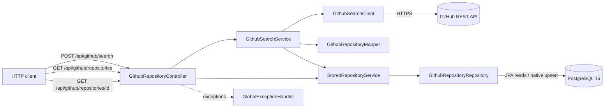
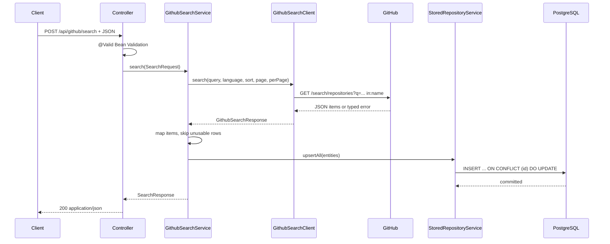

# GitHub Repository Searcher

## 1. Title, overview and live links

A Spring Boot REST API that searches GitHub repositories, stores them in PostgreSQL without duplicates, and lets you query the stored data without calling GitHub again. `POST /api/github/search` calls GitHub's search API once and upserts every result by GitHub's repository id; `GET /api/github/repositories` filters, sorts and paginates the rows already in PostgreSQL; `GET /api/github/repositories/{id}` returns one stored repository.

| Resource | URL |
| --- | --- |
| Live API base URL | TODO: add the deployed base URL in Phase 7 |
| Live Swagger UI | TODO: add the deployed Swagger URL in Phase 7 |
| Live health check | TODO: add the deployed health URL in Phase 7 |

> The application has **not been deployed yet**. Phase 7 prepared deployment; every `TODO` above is a placeholder, not a working link. Everything else in this README was verified against a local run, except the Render steps in Section 13, which are written but not executed; the Neon setup was executed and verified.

Locally the three resources are:

- API: `http://localhost:8080`
- Swagger UI: `http://localhost:8080/swagger-ui.html`
- Health: `http://localhost:8080/actuator/health`

The API is open: it has no authentication, no API keys and no browser frontend. It is a backend service for the assignment "GitHub Repository Searcher".

## 2. Problem statement

Searching GitHub on every page view is slow, spends a tight rate-limit quota, and gives no durable copy of the data. The assignment asks for a service that:

1. accepts search criteria and fetches matching repositories from GitHub;
2. saves the repositories in PostgreSQL without creating duplicates when the same repository is returned again;
3. serves the saved repositories with filtering, sorting and pagination, without calling GitHub;
4. validates input and reports failures with correct HTTP status codes and one consistent JSON error shape.

## 3. Features

Implemented:

- **Search and persist** — `POST /api/github/search` calls GitHub once, maps the results, and upserts them by GitHub id.
- **Upsert, not duplicate** — repeating the same search updates the existing rows through `INSERT ... ON CONFLICT (id) DO UPDATE`.
- **Name-only GitHub search** — the client sends `q=<query> in:name` (plus `language:<language>` when supplied). GitHub therefore matches the query against repository **names** only; descriptions, README text and topics are not searched.
- **Stored-data queries** — `GET /api/github/repositories` filters by language (case-insensitive exact match) and minimum stars, sorts by stars, forks or last updated in either direction, and paginates.
- **Single-repository read** — `GET /api/github/repositories/{id}` (the optional endpoint from the blueprint).
- **Validation** — Bean Validation on the request body and query parameters, including a whitelist for `sort` and `order`.
- **Consistent errors** — every non-2xx response uses the same `ErrorResponse` JSON body; stack traces and SQL never leave the server.
- **Swagger/OpenAPI** — generated from the controller with titles, descriptions, allowed values and realistic examples.
- **Health endpoint** — `GET /actuator/health` exposes only `{"status":"UP"}`.
- **Tests** — unit tests with Mockito, web-layer tests with `MockMvc`, GitHub client tests against a mocked HTTP server, and PostgreSQL integration tests with Testcontainers.

Optional features that were **not** built:

- authentication or API keys;
- CORS or a browser frontend;
- scheduled background refresh of stored repositories;
- retries of failed GitHub calls;
- bulk multi-row upsert (the service loops over at most 100 rows in one transaction);
- request metrics, tracing or a cache.

## 4. Architecture



Request flow for `POST /api/github/search`:



The controller only translates HTTP; `GithubSearchService` orchestrates the GitHub call and mapping; `StoredRepositoryService` owns the transaction and all database reads/writes. The GitHub client is the only class that knows GitHub's URL, headers, JSON shape and error codes. `GlobalExceptionHandler` is the single place that turns exceptions into HTTP responses.

## 5. Technology stack

| Technology | Version | Why it is here |
| --- | --- | --- |
| Java | 21 | Language level required by the project and `pom.xml`. |
| Spring Boot | 3.5.16 | Web, validation, data access, actuator and test auto-configuration. |
| Spring Web (MVC) | managed by Spring Boot 3.5.16 | REST controllers and the embedded Tomcat server. |
| Spring Data JPA / Hibernate | managed by Spring Boot 3.5.16 (Hibernate 6.6.x) | Entity mapping, specifications and paginated reads. |
| Bean Validation | managed by Spring Boot 3.5.16 | Declarative request and query-parameter validation. |
| PostgreSQL | 16 (`postgres:16` image) | Required database; supports `ON CONFLICT`, `TIMESTAMPTZ` and functional indexes. |
| Flyway | managed by Spring Boot 3.5.16 | Versioned schema creation (`V1__create_github_repositories.sql`). |
| springdoc-openapi | 2.10.0 | Generates `/v3/api-docs` and serves Swagger UI. |
| Maven Wrapper | included (`mvnw`, `mvnw.cmd`) | Reproducible build without a pre-installed Maven. |
| JUnit 5 | managed by Spring Boot 3.5.16 | Test framework. |
| Mockito | managed by Spring Boot 3.5.16 | Mock collaborators in unit tests. |
| Testcontainers | managed by Spring Boot 3.5.16 | Real PostgreSQL 16 for integration tests. |
| JaCoCo | 0.8.13 | Coverage report during `verify`. |

No Lombok, no MapStruct, no Spring Security.

## 6. Database schema

Flyway creates one table, `github_repositories`. Its 11 persisted repository fields plus `synced_at` are:

```sql
CREATE TABLE github_repositories (
    id                BIGINT        PRIMARY KEY,
    name              VARCHAR(255)  NOT NULL,
    description       TEXT,
    owner             VARCHAR(255)  NOT NULL,
    language          VARCHAR(100),
    stars             INTEGER       NOT NULL DEFAULT 0,
    forks             INTEGER       NOT NULL DEFAULT 0,
    last_updated      TIMESTAMPTZ,
    html_url          VARCHAR(500),
    open_issues_count INTEGER       NOT NULL DEFAULT 0,
    created_at        TIMESTAMPTZ,
    synced_at         TIMESTAMPTZ   NOT NULL DEFAULT now()
);

CREATE INDEX idx_repo_language_lower ON github_repositories (LOWER(language));
CREATE INDEX idx_repo_stars          ON github_repositories (stars DESC);
CREATE INDEX idx_repo_forks          ON github_repositories (forks DESC);
CREATE INDEX idx_repo_last_updated   ON github_repositories (last_updated DESC);
```

- `id` is GitHub's repository id, not a generated surrogate key. It is already unique and stable, so it is the primary key and the duplicate check.
- `synced_at` records when **this service** last wrote the row. It is set by the database (`now()`) and refreshed on every update, not supplied by GitHub.
- `TIMESTAMPTZ` plus the UTC JVM setting keeps timestamps unambiguous.
- The `LOWER(language)` index supports case-insensitive language filtering.

The write path is one native statement per row:

```sql
INSERT INTO github_repositories
    (id, name, description, owner, language, stars, forks, last_updated, html_url,
     open_issues_count, created_at, synced_at)
VALUES
    (:id, :name, :description, :owner, :language, :stars, :forks, :lastUpdated, :htmlUrl,
     :openIssues, :createdAt, now())
ON CONFLICT (id) DO UPDATE SET
    name              = EXCLUDED.name,
    description       = EXCLUDED.description,
    owner             = EXCLUDED.owner,
    language          = EXCLUDED.language,
    stars             = EXCLUDED.stars,
    forks             = EXCLUDED.forks,
    last_updated      = EXCLUDED.last_updated,
    html_url          = EXCLUDED.html_url,
    open_issues_count = EXCLUDED.open_issues_count,
    created_at        = EXCLUDED.created_at,
    synced_at         = now();
```

`EXCLUDED` is the pseudo-table holding the row that was proposed for insertion. `stars = EXCLUDED.stars` means "overwrite the stored stars with the incoming value". The insert and the conflict update are one atomic statement, so two concurrent searches cannot create duplicate rows. The whole batch runs in one transaction: if one row fails, the batch rolls back.

## 7. API documentation

Base URL in the examples: `http://localhost:8080`. The transcripts below were captured from a local run on port `8081` because port `8080` was already occupied on the author's machine; the paths, bodies and status codes are unchanged.

### 7.1 `POST /api/github/search`

Request body:

| Field | Required | Rules |
| --- | --- | --- |
| `query` | Yes | Not blank, at most 256 characters. Matched against repository names (`in:name`). |
| `language` | No | At most 50 characters; letters, digits, spaces and `+ # . -`. `C++`, `C#` and `Jupyter Notebook` are allowed. |
| `sort` | No | `stars`, `forks` or `updated` (case-insensitive). Omitted means GitHub best match. |
| `page` | No | One-based, at least 1; default 1. |
| `perPage` | No | 1 to 100; default 30. `page * perPage` must be at most 1000. |

```bash
curl -s -X POST http://localhost:8080/api/github/search \
  -H "Content-Type: application/json" \
  -d '{"query":"spring boot","language":"Java","sort":"stars","page":1,"perPage":1}'
```

> On Windows PowerShell, `curl.exe` can strip the quotes from an inline JSON argument. Save the body to a file (for example `body.json`) and use `--data-binary "@body.json"` instead.

Real response (`200 OK`, one result requested):

```json
{"message":"Repositories fetched and saved successfully","repositories":[{"id":6296790,"name":"spring-boot","description":"Spring Boot helps you to create Spring-powered, production-grade applications and services with absolute minimum fuss.","owner":"spring-projects","language":"Java","stars":81897,"forks":42726,"lastUpdated":"2026-11-18T09:01:47Z","htmlUrl":"https://github.com/spring-projects/spring-boot","openIssues":489,"createdAt":"2012-10-19T15:02:57Z"}]}
```

A search that matches nothing is still `200 OK` with an empty array and the message `No repositories found for the given search criteria`; nothing is written.

Status codes: `200` success (including zero matches), `400` invalid body/sort or GitHub rejected the query, `429` GitHub rate limit (with `Retry-After` when known), `502` GitHub unavailable/unreadable, `503` database unavailable, `504` GitHub timeout, `500` unexpected server error.

### 7.2 `GET /api/github/repositories`

| Query parameter | Required | Default | Rules |
| --- | --- | --- | --- |
| `language` | No | none | Case-insensitive exact match; at most 50 characters. |
| `minStars` | No | none | Integer at least 0. |
| `sort` | No | `stars` | `stars`, `forks` or `updated`. |
| `order` | No | `desc` | `asc` or `desc`. |
| `page` | No | `0` | Zero-based; at least 0. |
| `size` | No | `100` | 1 to 100. |

```bash
curl -s "http://localhost:8080/api/github/repositories?language=Java&minStars=80000&sort=stars"
```

Real response (`200 OK`):

```json
{"repositories":[{"id":6296790,"name":"spring-boot","description":"Spring Boot helps you to create Spring-powered, production-grade applications and services with absolute minimum fuss.","owner":"spring-projects","language":"Java","stars":81897,"forks":42726,"lastUpdated":"2026-11-18T09:01:47Z","htmlUrl":"https://github.com/spring-projects/spring-boot","openIssues":489,"createdAt":"2012-10-19T15:02:57Z"}],"page":0,"size":100,"totalElements":1,"totalPages":1}
```

No matching rows is still `200 OK` with `"repositories":[]`. This endpoint never calls GitHub.

Invalid sort example:

```bash
curl -s "http://localhost:8080/api/github/repositories?sort=rating"
```

Real response (`400 Bad Request`):

```json
{"timestamp":"2026-11-18T09:03:00.514213900Z","status":400,"error":"Bad Request","message":"Invalid sort field 'rating'. Allowed values: stars, forks, updated","path":"/api/github/repositories"}
```

### 7.3 `GET /api/github/repositories/{id}`

```bash
curl -s http://localhost:8080/api/github/repositories/6296790
```

Real response (`200 OK`):

```json
{"id":6296790,"name":"spring-boot","description":"Spring Boot helps you to create Spring-powered, production-grade applications and services with absolute minimum fuss.","owner":"spring-projects","language":"Java","stars":81897,"forks":42726,"lastUpdated":"2026-11-18T09:01:47Z","htmlUrl":"https://github.com/spring-projects/spring-boot","openIssues":489,"createdAt":"2012-10-19T15:02:57Z"}
```

Unknown id (`404 Not Found`):

```json
{"timestamp":"2026-11-18T09:00:42.431504300Z","status":404,"error":"Not Found","message":"Repository with id 999999999999 was not found","path":"/api/github/repositories/999999999999"}
```

A non-numeric id returns `400`.

### 7.4 Standard error body

Every non-2xx response has this shape. `details` appears only when field-level validation produced more than one problem.

```json
{
  "timestamp": "2026-11-18T09:00:42.318322700Z",
  "status": 400,
  "error": "Bad Request",
  "message": "Request validation failed",
  "path": "/api/github/search",
  "details": [
    { "field": "perPage", "message": "perPage must be less than or equal to 100" },
    { "field": "query", "message": "query must not be blank" }
  ]
}
```

No stack trace, SQL, exception class name or GitHub token is ever returned.

A ready-to-import Postman collection is in [`docs/postman/github-searcher.postman_collection.json`](docs/postman/github-searcher.postman_collection.json). It uses a collection-level `baseUrl` variable and contains the search, the repeated search (upsert), the filtered GET, the invalid-sort GET and the get-by-id request.

## 8. Environment variables

Spring Boot does **not** read `.env` automatically. Export the variables in your shell, set them in your IDE run configuration, or pass them to your container.

| Variable | Required | Default in `application.yml` | Purpose |
| --- | --- | --- | --- |
| `DB_URL` | Yes in practice | `jdbc:postgresql://localhost:5432/github_searcher` | JDBC URL of the PostgreSQL database. Hosted providers often give `postgres://...`; convert it to `jdbc:postgresql://<host>:<port>/<database>`. |
| `DB_USERNAME` | Yes in practice | `postgres` | Database user. |
| `DB_PASSWORD` | Yes in practice | `postgres` | Database password. Never commit the real value. |
| `GITHUB_TOKEN` | No | empty | Optional GitHub token. Without it, GitHub's already-low anonymous search quota applies. A classic or fine-grained token with no scopes is enough for public search. Never commit it. |
| `PORT` | No | `8080` | HTTP port. Most hosting platforms inject this themselves. |
| `SPRING_PROFILES_ACTIVE` | No | empty | Set to `prod` for deployments. The prod profile keeps `ddl-auto=validate`, reduces SQL logging and disables health details. |

Neon users can skip the manual conversion: leave `DB_URL` empty and export `DATABASE_URL` (pooled) and `DATABASE_URL_UNPOOLED` (direct). `NeonEnvironmentPostProcessor` converts both to JDBC, uses the pooled one for request traffic and the direct one for Flyway, keeps only `sslmode` from the query string, and leaves an explicit `DB_URL` untouched. The classes are `src/main/java/com/example/githubsearch/config/NeonEnvironmentPostProcessor.java` and its unit test.

`.env.example` lists every variable with a comment. Copy it to `.env` for your own reference, but export the values yourself because Spring ignores the file.

## 9. Local setup

Prerequisites:

- Java 21 (`java -version` must report 21). If another JDK is first on `PATH`, point `JAVA_HOME` at the JDK 21 installation for that shell; for example on Windows: `$env:JAVA_HOME="C:\path\to\jdk-21"` and prepend `"$env:JAVA_HOME\bin"` to `PATH`.
- Docker Desktop (or another Docker engine) for PostgreSQL and for the Testcontainers integration tests.
- Git. Maven is **not** required: the project includes the Maven Wrapper.

Start PostgreSQL:

```bash
docker run --name gh-pg \
  -e POSTGRES_PASSWORD=postgres \
  -e POSTGRES_DB=github_searcher \
  -p 5432:5432 \
  -d postgres:16
```

If port 5432 is already in use, publish a different host port and point `DB_URL` at it:

```bash
docker run --name gh-pg \
  -e POSTGRES_PASSWORD=postgres \
  -e POSTGRES_DB=github_searcher \
  -p 5433:5432 \
  -d postgres:16
```

Then use `DB_URL=jdbc:postgresql://localhost:5433/github_searcher`.

If the container starts but the app reports `password authentication failed`, another PostgreSQL may already own the host port and be answering instead of the container. Check `docker ps` and `Get-NetTCPConnection -State Listen -LocalPort 5432` (or `lsof -i :5432`), stop the conflicting service or publish the container on a different host port, and update `DB_URL` to match.

Set the variables.

PowerShell:

```powershell
$env:DB_URL="jdbc:postgresql://localhost:5432/github_searcher"
$env:DB_USERNAME="postgres"
$env:DB_PASSWORD="postgres"
$env:GITHUB_TOKEN=""   # optional
$env:PORT="8080"
$env:SPRING_PROFILES_ACTIVE=""
```

Bash / macOS / Linux:

```bash
export DB_URL="jdbc:postgresql://localhost:5432/github_searcher"
export DB_USERNAME="postgres"
export DB_PASSWORD="postgres"
export GITHUB_TOKEN=""   # optional
export PORT="8080"
export SPRING_PROFILES_ACTIVE=""
```

Flyway creates the table and indexes on startup; there is no manual SQL step. The database itself must already exist (`POSTGRES_DB=github_searcher` creates it in the Docker command above).

## 10. Run the app

```powershell
.\mvnw.cmd spring-boot:run
```

```bash
./mvnw spring-boot:run
```

`spring-boot:run` uses the UTC JVM setting configured in `pom.xml`. If you run the packaged jar directly, pass it yourself:

```bash
java -Duser.timezone=UTC -jar target/github-repository-searcher-0.0.1-SNAPSHOT.jar
```

Check it is up:

```bash
curl -s http://localhost:8080/actuator/health
```

```json
{"status":"UP"}
```

If port 8080 is already in use, set `PORT` to a free port before starting and use that port in the URLs (for example `PORT=8082`).

Then open Swagger UI or call the API with the examples in Section 7.

## 11. Run the tests

```powershell
.\mvnw.cmd test
.\mvnw.cmd clean verify
```

```bash
./mvnw test
./mvnw clean verify
```

Docker must be running: the integration tests start a real `postgres:16` container with Testcontainers, use it through `@ServiceConnection`, and stop it afterwards. There is no H2 fallback, because the design depends on PostgreSQL-specific behaviour (`ON CONFLICT`, `LOWER(language)` indexes, null ordering).

The current suite runs **191 tests with 0 failures, 0 errors and 0 skipped** (`mvnw clean verify`).

The suite covers:

- **Unit tests** — service orchestration, mapping, sort whitelisting and error translation with Mockito.
- **Web-layer tests** — status codes, validation, the standard error body and the OpenAPI contract with `MockMvc`.
- **Client tests** — `MockRestServiceServer` returns canned GitHub responses: success, 403/429, 401, 5xx, malformed JSON and timeouts.
- **Integration tests** — repository specifications, pagination and the upsert against real PostgreSQL (save the same id twice, assert one row with the updated value).

The coverage report is generated by `verify` at:

```text
target/site/jacoco/index.html
```

## 12. Swagger URL

Local:

- UI: `http://localhost:8080/swagger-ui.html` (redirects to `/swagger-ui/index.html`)
- Raw OpenAPI JSON: `http://localhost:8080/v3/api-docs`

Deployed: TODO: add the deployed Swagger UI URL in Phase 7.

The document is built from `OpenApiConfig` (title, description, version `0.0.1-SNAPSHOT`) and the controller annotations. It lists all three endpoints, the allowed sort/order values, every possible status code, the `Retry-After` header on `429`, and examples for both request and response schemas. Try-it-out works against the same running server.

## 13. Deployment steps used

**Status: Neon provisioned, app not deployed.** The Neon project `crimson-cell-36243677` (branch `production`, database `neondb`, region `ap-southeast-1`) is linked in this workspace, and `.env` holds `DATABASE_URL` and `DATABASE_URL_UNPOOLED`. The image was run locally against that database and all checks below passed. No Render service or public URL exists yet, so the live links at the top of this README are still `TODO` placeholders.

Chosen combination: **Render** builds the repository's `Dockerfile` and runs it as a Docker web service; **Neon** hosts PostgreSQL. Render's own free PostgreSQL was deliberately not used because those free databases expire.

### 13.1 What the Dockerfile does

`Dockerfile` is a two-stage build:

| Stage | Base image | Job |
| --- | --- | --- |
| `build` | `maven:3.9.11-eclipse-temurin-21` | Copies `pom.xml`, runs `mvn dependency:go-offline`, then copies `src` and runs `mvn -DskipTests package`. |
| runtime | `eclipse-temurin:21-jre-jammy` | Copies only the built jar, runs as the non-root `app` user, exposes 8080 and starts `java -Duser.timezone=UTC -jar /app/app.jar`. |

Both tags are pinned to specific versions (never `latest`) and were verified with `docker manifest inspect`.

Why it is shaped that way:

- **`pom.xml` is copied before `src`.** Docker caches each instruction. As long as the POM does not change, a source-only change reuses the dependency layer instead of downloading Maven Central again.
- **The runtime stage contains no build tools, source, Maven cache or `.env`.** Only the jar is copied across, so the image cannot leak local files.
- **Non-root user.** A compromised process gets `app`'s permissions, not root inside the container.
- **UTC.** `ENV TZ=UTC` sets the container clock and `-Duser.timezone=UTC` sets the JVM zone; Hibernate also binds timestamps as UTC (`spring.jpa.properties.hibernate.jdbc.time_zone=UTC`). Stored instants therefore do not depend on the host's timezone.
- **`EXPOSE 8080` is documentation only.** Render injects `PORT` and the app reads `server.port=${PORT:8080}`; do not hardcode 8080 in Render.
- **No secrets are baked in.** Every credential arrives as a runtime environment variable.

`.dockerignore` keeps `.git`, `target`, `.env`, IDE files, logs and docs out of the build context. Excluding `.env` matters: build args and copied files can both end up in image layers.

`SPRING_PROFILES_ACTIVE=prod` activates `application-prod.yml`: `ddl-auto=validate`, `open-in-view=false`, `show-sql=false`, Flyway enabled, only the `health` actuator endpoint exposed (without component details), and INFO logging with Hibernate SQL at WARN. It contains no secrets.

### 13.2 Verify the image locally

Build:

```bash
docker build -t github-repository-searcher:phase7 .
```

Run it against the local PostgreSQL container from Section 9. On Docker Desktop, `host.docker.internal` reaches the host, so a database published on host port 5433 is reachable:

```bash
docker run --rm -p 8083:8080 \
  -e SPRING_PROFILES_ACTIVE=prod \
  -e DB_URL="jdbc:postgresql://host.docker.internal:5433/github_searcher" \
  -e DB_USERNAME="postgres" \
  -e DB_PASSWORD="postgres" \
  github-repository-searcher:phase7
```

```powershell
docker run --rm -p 8083:8080 `
  -e SPRING_PROFILES_ACTIVE=prod `
  -e DB_URL="jdbc:postgresql://host.docker.internal:5433/github_searcher" `
  -e DB_USERNAME="postgres" `
  -e DB_PASSWORD="postgres" `
  github-repository-searcher:phase7
```

Then, in another shell:

```bash
curl -s http://localhost:8083/actuator/health
curl -s -o /dev/null -w "%{http_code}\n" http://localhost:8083/swagger-ui.html
curl -s -o /dev/null -w "%{http_code}\n" http://localhost:8083/v3/api-docs
```

Local results are recorded in the Phase 7 completion report. `--rm` deletes the container when it stops; the image stays.

### 13.3 Create the Neon database

The project used here was linked and deployed with:

```bash
neon init -y --org-id org-purple-pine-68944034 \
  --project-id crimson-cell-36243677 --branch production --services postgres
neon deploy
```

`neon deploy` writes `DATABASE_URL`, `DATABASE_URL_UNPOOLED`, `NEON_BRANCH`, `NEON_BRANCH_ID` and `NEON_FUNCTION_HOST_SUFFIX` into `.env` (the existing `DB_*` keys are preserved). To reproduce from scratch:

1. Sign in at <https://console.neon.tech> and create a project (any region close to the Render region you will pick).
2. Neon creates a database and an owner role. Open **Connect** (or **Dashboard → Connection string**) and copy the connection string. It looks like:

   ```text
   postgresql://neondb_owner:<password>@ep-<endpoint>-<region>.aws.neon.tech/neondb?sslmode=require
   ```

3. Convert it. Spring needs a JDBC URL and separate credentials:

   | Piece of the Neon string | Becomes |
   | --- | --- |
   | `postgresql://` | `jdbc:postgresql://` |
   | `neondb_owner:<password>@` | removed; password goes in `DB_PASSWORD`, role in `DB_USERNAME` |
   | `ep-...neon.tech` | host, keep as-is |
   | `/neondb` | database name, keep as-is |
   | `?sslmode=require` | keep; Neon requires TLS |

   Result:

   ```text
   DB_URL=jdbc:postgresql://ep-<endpoint>-<region>.aws.neon.tech/neondb?sslmode=require
   DB_USERNAME=neondb_owner
   DB_PASSWORD=<the password from the string>
   ```

   If the copied host contains `-pooler`, that is Neon's pooled endpoint. For a single small instance either endpoint works; the **direct** host (without `-pooler`) is the safer choice because Flyway runs migrations during application startup and direct connections avoid transaction-pooling edge cases. If Neon's string contains extra parameters such as `channel_binding`, keep only `sslmode=require` in `DB_URL`.

   Instead of converting by hand, you can let the app do it: leave `DB_URL` empty and provide `DATABASE_URL` (pooled) plus `DATABASE_URL_UNPOOLED` (direct). `NeonEnvironmentPostProcessor` builds both JDBC URLs, decodes the credentials, drops `channel_binding`, uses the pooled URL for requests and the direct URL for Flyway. `neon deploy` already wrote both variables into `.env`; export them (or pass them to the container) and start the app.

4. Do not create tables. Flyway runs `src/main/resources/db/migration/*.sql` on the first startup of the app.

Keep the password out of Git, screenshots and chat. If it leaks, reset the role password in Neon and update `DB_PASSWORD` in Render.

### 13.4 Create the Render web service

1. Push this repository (including `Dockerfile` and `.dockerignore`) to GitHub.
2. In <https://dashboard.render.com> choose **New → Web Service** and connect the repository.
3. Use these settings:

   | Setting | Value |
   | --- | --- |
   | Language | **Docker** |
   | Branch | your default branch, for example `main` |
   | Region | closest to you / to Neon |
   | Root Directory | repository root (leave empty) |
   | Dockerfile Path | `./Dockerfile` |
   | Docker Command | leave empty; the image's `ENTRYPOINT` starts the app |
   | Health Check Path | `/actuator/health` |
   | Instance Type | choose the free instance if your account offers it |

4. Add the environment variables under **Environment**. Render injects `PORT` itself, so **do not set `PORT=8080`**; if you set it explicitly, it must match Render's port (usually `10000`).

   | Variable | Value |
   | --- | --- |
   | `DB_URL` | `jdbc:postgresql://<neon-host>/<database>?sslmode=require` |
   | `DB_USERNAME` | Neon role, for example `neondb_owner` |
   | `DB_PASSWORD` | Neon password |
   | `GITHUB_TOKEN` | optional; empty is allowed. A token with no scopes raises GitHub's rate limit. |
   | `SPRING_PROFILES_ACTIVE` | `prod` |
   | `PORT` | injected by Render; leave it unset |

   Mark `DB_PASSWORD` and `GITHUB_TOKEN` as secret. Render exposes environment variables to Docker builds as build args, so never reference them in the `Dockerfile`; this image does not.

   Alternative: instead of `DB_URL`/`DB_USERNAME`/`DB_PASSWORD`, add `DATABASE_URL` (Neon pooled) and `DATABASE_URL_UNPOOLED` (Neon direct). The app converts them at startup and uses the direct URL for Flyway. Keep the three `DB_*` variables if you prefer the explicit form; `DB_URL` wins when both are present.

5. Optional on a small instance, add `JAVA_TOOL_OPTIONS=-XX:MaxRAMPercentage=75` so the JVM sizes its heap from the container limit instead of the host's total memory. It is not baked into the image.
6. Choose **Create Web Service**. Render builds the Dockerfile. The first build downloads Maven dependencies and takes several minutes; later builds reuse cached layers.
7. Watch the logs. Success looks like Flyway applying the migration, Tomcat starting on Render's `PORT`, and `Started GithubRepositorySearcherApplication`. A Flyway or `password authentication failed` error means the database variables are wrong; fix them and redeploy.

Render gives the service a URL like `https://<service-name>.onrender.com`. Free instances may sleep when idle and take about a minute to wake.

### 13.5 Verify the deployment

Run all six checks from Blueprint Section 14 against the Render URL.

1. Health is UP:

   ```bash
   curl -s https://<service-name>.onrender.com/actuator/health
   ```

   ```json
   {"status":"UP"}
   ```

2. Swagger UI loads in a browser: `https://<service-name>.onrender.com/swagger-ui.html` (it redirects to `/swagger-ui/index.html`). Raw spec: `https://<service-name>.onrender.com/v3/api-docs`.

3. Search stores repositories:

   ```bash
   curl -s -X POST https://<service-name>.onrender.com/api/github/search \
     -H "Content-Type: application/json" \
     -d '{"query":"spring boot","language":"Java","sort":"stars","page":1,"perPage":1}'
   ```

   Expect `200` and a `repositories` array.

4. Repeat the same POST. It must still return `200`; the upsert updates the existing row instead of failing on the primary key.

5. Read the stored rows without calling GitHub:

   ```bash
   curl -s "https://<service-name>.onrender.com/api/github/repositories?language=Java&minStars=100&sort=stars"
   ```

6. An invalid sort returns `400` in the standard error shape:

   ```bash
   curl -s "https://<service-name>.onrender.com/api/github/repositories?sort=rating"
   ```

PowerShell users: `curl.exe` can strip quotes from inline JSON. Put the body in `body.json` and use `--data-binary "@body.json"`.

When the checks pass, replace the three `TODO` rows at the top of this README and the deployed Swagger line in Section 12 with the real URLs. Until then they remain placeholders.

### 13.6 Troubleshooting

| Symptom | Likely cause |
| --- | --- |
| Container exits immediately | Missing/incorrect `DB_URL`, `DB_USERNAME` or `DB_PASSWORD`; read the Render logs. |
| `password authentication failed` | Wrong Neon password, or the URL points at a different role/database. |
| `SSL connection is required` / TLS error | `?sslmode=require` is missing from `DB_URL`. |
| Flyway cannot connect | `DB_URL` still starts with `postgresql://` or contains the password; it must start with `jdbc:postgresql://` and contain only host, port, database and `sslmode`. |
| `502` on search with a token configured | The GitHub token is invalid or expired; clear `GITHUB_TOKEN` to test anonymously. |
| `429` | GitHub rate limit; wait, or configure a valid token. |
| Health check fails but the app logs startup | `PORT` was hardcoded to 8080 instead of letting Render inject it. |
| First request after idle is slow | Free instances sleep; open the health URL a minute before a reviewer does. |

## 14. Design decisions

| Decision | Why |
| --- | --- |
| Layered controller → service → client/repository | Each layer has one job and can be tested without the others. The controller stays thin enough to read in one screen. |
| DTOs at the API edge, never entities | The JSON contract does not change when a column or association changes, and Hibernate internals cannot leak. |
| GitHub id as the primary key | It is already unique and stable, so no surrogate key or extra unique constraint is needed. |
| Database-level upsert | `ON CONFLICT (id) DO UPDATE` is atomic and race-free. `save()` with an assigned id would do a SELECT first (two round trips) and could still race. |
| Two services (`GithubSearchService`, `StoredRepositoryService`) | The slow GitHub HTTP call does not hold a database transaction or connection. Keeping `@Transactional` on a different bean also avoids Spring's self-invocation trap. |
| Dedicated `GithubSearchClient` | GitHub's URL building, headers, rate limits and JSON shape are isolated; the service can be tested with a mock. |
| Filtering and sorting in SQL | The database is efficient at it; Java would have to load every row first. The `sort` value is whitelisted, so client text never becomes an arbitrary column name. |
| Bean Validation at the edge | Invalid input is rejected before GitHub is called, so a typo costs no quota. |
| Flyway owns the schema, `ddl-auto=validate` | Migrations are explicit and repeatable; Hibernate only checks that the mapping matches. |
| One `ErrorResponse` shape | A client needs one parser for every failure, and the server has one place (`GlobalExceptionHandler`) that decides status codes. |
| No retries | Searches are user-initiated and the quota is tight; retrying a 429 or timeout usually makes it worse. A single retry on a 5xx is a reasonable future extension. |
| Testcontainers instead of H2 | The upsert and functional index are PostgreSQL behaviour; H2 can pass while production fails. |
| Neon URL adapter, `DB_URL` wins | Neon hands out `postgresql://…`, which JDBC cannot use directly. A small `EnvironmentPostProcessor` converts it, sends runtime traffic to the pooled endpoint and Flyway to the direct one, and steps aside when an explicit `DB_URL` is set. |

## 15. Known limitations

- **Open API, no authentication.** Anyone who can reach the service can search and read. There is no API key, user account or per-client rate limit. CORS is deliberately off because no browser frontend is included.
- **GitHub search is name-only.** The query is sent as `<words> in:name`, so matches depend on repository names. Descriptions, README content and topics are ignored. This is intentional and is the exact qualifier the client builds.
- **GitHub's 1000-result cap.** GitHub returns at most 1000 search results; the request validator rejects `page * perPage > 1000`. Deep result sets are not available through this API.
- **GitHub rate limits.** Anonymous search has a low per-minute quota and the search endpoint is the most restricted. An optional `GITHUB_TOKEN` raises the limit. A rate-limited call becomes `429` with `Retry-After` when GitHub supplied one.
- **GitHub timeouts.** Connect timeout is 5 seconds and read timeout is 10 seconds; either becomes `504`. There are no automatic retries.
- **Stored data is only as fresh as the last search.** There is no scheduled refresh, webhook or background sync. A row stays unchanged until a later search returns that repository again.
- **Sequential upsert.** The service loops over at most 100 rows and calls one upsert per row inside a single transaction. This is simple and correct, but a bulk `INSERT ... VALUES (...), (...)` would be faster at larger volumes.
- **GitHub id as the only key.** If repositories from a second source were stored in the same table, their ids could collide. Supporting multiple sources would need a composite key.
- **Free-host cold starts.** The project is not deployed yet; if a free container host is used in Phase 7, the first request after idling may take about a minute while the instance wakes.
